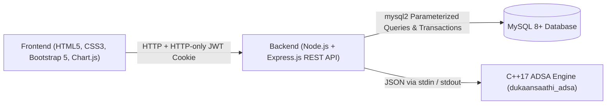

# DukaanSaathi – Smart Business Management System

DukaanSaathi is a full-stack business management platform built for small Indian retail businesses (Kirana stores, grocery shops, stationery stores, clothing retailers, and small wholesalers). It replaces traditional paper registers with a persistent MySQL 8+ database, accurate **FIFO (First-In, First-Out)** inventory costing, real-time **Profit & Loss** analytics, and a compiled **C++17 ADSA (Analysis and Design of Algorithms)** engine.

---

## System Architecture



## Tech Stack
- **Frontend:** HTML5, CSS3, Bootstrap 5, Bootstrap Icons, Chart.js, Vanilla JavaScript
- **Backend:** Node.js, Express.js, `mysql2`, `bcrypt`, `jsonwebtoken`, `cookie-parser`, `express-rate-limit`, `express-validator`
- **Database:** MySQL 8+ (12 normalized tables, `DECIMAL(12,2)` monetary columns, `InnoDB` transactions, business-level isolation)
- **ADSA Engine:** C++17 compiled with CMake + MinGW `g++ 13.2.0` + Ninja

---

## Demo Credentials
- **Store:** Sharma General Store (10 Indian retail products, FIFO batches, sample sales, purchases, and expenses)
- **Email:** `sharma@dukaansaathi.in`
- **Password:** `Demo@1234`
- You can reset the demo data anytime from **Settings → Reset Demo Data**.

---

## Setup & Installation

### 1. Database Setup (MySQL 8+)
1. Ensure MySQL 8+ is running on port `3306`.
2. Run [`database/schema.sql`](database/schema.sql) to create the `dukaansaathi` database and all 12 tables:
   ```powershell
   Get-Content database/schema.sql -Raw | mysql -u root -p
   ```

### 2. Build the C++ ADSA Engine
```powershell
cmake -S algorithms -B algorithms/build -G Ninja -DCMAKE_CXX_COMPILER=g++
cmake --build algorithms/build
```
Run C++ unit tests:
```powershell
.\algorithms\build\adsa_tests.exe
```

### 3. Configure Environment & Run Backend
1. Copy `.env.example` to `.env` and update `DB_PASSWORD` and `JWT_SECRET`.
2. Install dependencies and start the server:
   ```powershell
   cd backend
   npm install
   npm start
   ```
3. Open `http://localhost:5000` in your browser.

---

## API Endpoints Overview
- **Auth:** `POST /api/auth/register`, `POST /api/auth/login`, `POST /api/auth/logout`, `GET /api/auth/me`
- **Products & Inventory:** `GET /api/products`, `GET /api/products/search` (C++ Binary Search), `GET /api/products/sort` (C++ Merge Sort), `POST /api/products`, `PUT /api/products/:id`, `DELETE /api/products/:id` (Archive safeguard)
- **Purchases:** `GET /api/purchases`, `POST /api/purchases` (creates FIFO `inventory_batches`), `PUT /api/purchases/:id`
- **Sales:** `GET /api/sales` (C++ Quick Sort), `GET /api/sales/:id`, `POST /api/sales` (MySQL transaction + C++ FIFO COGS)
- **Expenses:** `GET /api/expenses`, `POST /api/expenses`, `PUT /api/expenses/:id`, `DELETE /api/expenses/:id`
- **Dashboard, P&L & Reports:** `GET /api/dashboard`, `GET /api/pnl`, `GET /api/reports/:type`, `GET /api/reports/:type/csv`, `GET /api/settings`, `PUT /api/settings`, `POST /api/demo/reset`

---

## Testing Report
- **C++ Unit Tests (`adsa_tests.exe`):** All 5 test suites passed (Binary Search, Merge Sort, Quick Sort, FIFO Inventory & Financial Scenario, Top-Selling Heap & Profitability).
- **End-to-End Integration Tests (`backend/npm test`):** All 3 integration suites passed, verifying:
  - Protected route authentication & logout
  - Demo account login & seeded dashboard metrics
  - Financial accuracy test: Purchase 100 @ ₹20 + 50 @ ₹25, sell 120 @ ₹40, expense ₹300 → Revenue `₹4,800`, COGS `₹2,500`, Gross Profit `₹2,300`, Expenses `₹300`, Net Profit `₹2,000`, Remaining Inventory `30 units` valued at `₹750`
  - Insufficient stock prevention, product archive safeguard, CSV export, and cross-business user isolation
